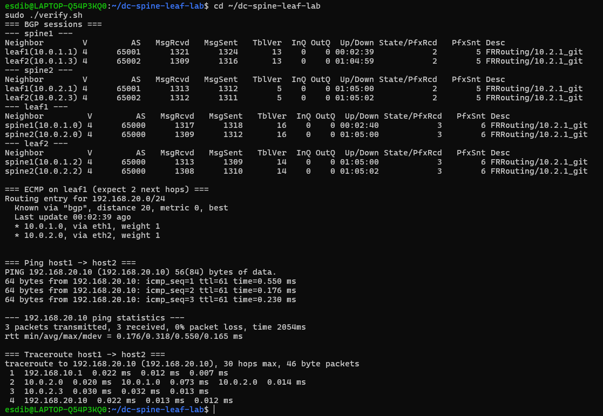
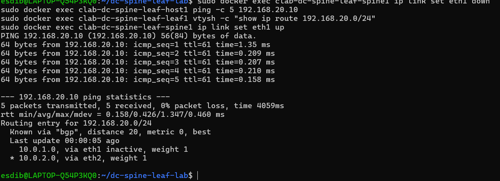

# Data Center Spine-Leaf Fabric Lab

Virtual data center network built with **containerlab** and **FRRouting**: a 2-tier spine-leaf (Clos) topology with an **eBGP underlay**, **ECMP** load balancing and **BFD** fast failure detection.

## Topology

       spine1 (AS65000)      spine2 (AS65000)
            |     \          /     |
            |      \        /      |
       leaf1 (AS65001)      leaf2 (AS65002)
            |                      |
       host1 192.168.10.10    host2 192.168.20.10

## Design decisions
- **Spine-leaf**: every leaf is two hops from any other leaf, giving predictable latency and horizontal scaling.
- **eBGP underlay** (RFC 7938): one ASN per leaf, shared ASN on spines.
- **/31 point-to-point links** to save address space.
- **ECMP**: traffic between leaves is load-balanced across both spines.
- **BFD** for fast failure detection.

## Results
- Both spines installed as equal-cost next hops on every leaf.
- Traceroute shows traffic hashed across both spines.
- **Failure test**: with the spine1-leaf1 link down, traffic fails over to spine2 in about 1 second. Flows already hashed to spine2 see 0% loss; flows on the failed path lose about one packet during reconvergence.

## Screenshots

**BGP sessions, ECMP and traceroute across both spines**

**Failover test (spine1-leaf1 link down)**

## Run it

    sudo containerlab deploy -t topology.clab.yml
    ./verify.sh

## Roadmap
- [x] eBGP underlay, ECMP, BFD, failure testing
- [ ] VXLAN/EVPN overlay
- [ ] Automation with Python/Ansible
- [ ] Monitoring (Prometheus + Grafana)

## Author
Manar Eddib, Computing student (Level 7), Dublin.
